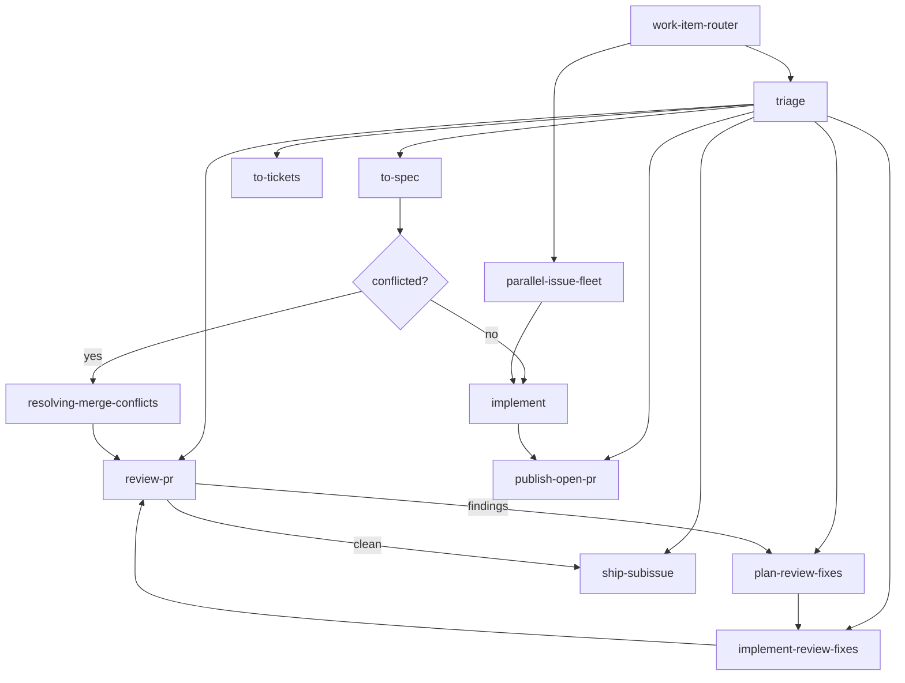

# Agent Skills Index

Operating map for the repository-local Skills bundle in `.agents/skills/` and the first
stop after `work-item-router` for any work-item, project-board or publication flow.

- `.agents/skills/` is canonical; `.claude/skills/` is only a compatibility symlink view.
- `.agents/adr/` holds architecture decision records.
- Tracker: GitHub Issues and GitHub Projects in `quantumquirkxyz/WorkBridge`.

## Work item flow

| Step | Skill | Role |
|---|---|---|
| 0 | `work-item-router` | Reads this index and returns the routing decision. Routes only. |
| 1 | `triage` | Classifies incoming issues and PRs into the canonical triage states. |
| 2 | `to-spec` | Publishes the initiative spec as one `[spec]` issue. |
| 3 | `make-project` | Creates the GitHub Project board, fields and views. |
| 4 | `wayfinder` | Maps work that exceeds one agent session into decision tickets. |
| 5 | `to-tickets` | Publishes tracer-bullet tickets as sub-issues with explicit blockers. |
| 6 | `implement` | Implements one claimable ticket on a short-lived branch. |
| 7 | `publish-open-pr` | Pushes the branch and opens the PR (no new commits). |
| 8 | `review-pr` | Reviews Standards and Spec on two separate axes. |
| 9 | `plan-review-fixes` / `implement-review-fixes` | Plans and applies review corrections. |
| 10 | `ship-subissue` | Merges, closes the issue and syncs the tracker. |
| 11 | `parallel-issue-fleet` | Opt-in: runs the claimable wave in isolated worktrees. |

`worktree-swarm` and `parallel-issue-fleet` are opt-in. They never inherit push, PR,
merge or issue-close authority. If a PR branch is conflicted, `resolving-merge-conflicts`
owns the branch state before review or shipping resumes.

## Configuration docs

| Document | Purpose |
|---|---|
| [Issue tracker](issue-tracker.md) | Tracker configuration and `gh` conventions |
| [Work item format](work-item-format.md) | Canonical metadata for specs, tickets and PRs |
| [Domain docs](domain.md) | Domain vocabulary layout and documentation rules |
| [Triage labels](triage-labels.md) | Canonical triage label vocabulary |

## Project rules that override defaults

- The issue tracker is GitHub Issues in `quantumquirkxyz/WorkBridge` (ADR-0012).
- Work items live on the **WorkBridge — Professional Pilot Delivery** board
  (https://github.com/users/quantumquirkxyz/projects/27, project number 27).
- Milestones are releases, not sprints. Sprints live in the project's `Sprint` field.
- Work-item state lives in the project's `Status` field, not in state labels. There is no
  `Phase` field: planning artifacts are kept out of execution by label, never by a second
  status. The canonical field table, including the six `Status` values, lives in
  [Work item format](work-item-format.md#metadata).
- Domain invariants in `CONTEXT.md` and `AGENTS.md` are binding for every ticket.
- Documentation language: product docs in Spanish, governance docs and ADRs in English.
